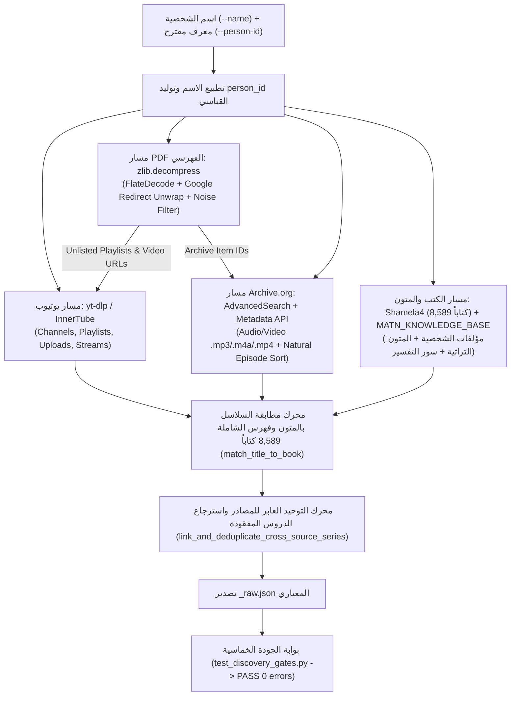

# مهارة `person-discovery-intake`: الاكتشاف الشامل والحصاد الموحد لتراث الأعلام والمشايخ من الاسم فقط

توثق هذه المهارة المعمارية القياسية، والخوارزميات الحتمية، والقواعد الذهبية للانتقال من **«اسم الشخصية فقط»** (أو اسمها مع بعض الروابط الأولية) إلى بناء ملف الجرد الخام الموحد `<person_id>_raw.json` الجاهز تماماً للتنقيح عبر مهارة `sheikh-curation` بمعيار **صفر خطأ (`0 Errors`)**.

تعالج هذه المهارة جذرياً مشكلة تشتت تراث العلماء والمفكرين بين قنوات رسمية وأرشيفية متعددة، وقوائم تشغيل غير مدرجة (`Unlisted Playlists`) مدفونة داخل ملفات `PDF` فهرسية (مثل «جمهرة أعمال م. أيمن عبد الرحيم»)، وحزم صوتية ومرئية على `Archive.org` ناقصة التوثيق في المواقع الرسمية أو متممة للحلقات الساقطة من يوتيوب (مثل الدرس 24 من «إيصال السالك» أو الدرس 28 من «العقيدة الطحاوية»)، وربط السلاسل بالمتون العلمية المشروحة ومؤلفات الشخصية عبر فهارس `turathmcp` والفهرس الكامل للمكتبة الشاملة (`Shamela4_Full_DB` — 8,589 كتاباً).

---

## 1. المبادئ الحاكمة والقواعد الذهبية (Golden Rules)

1. **الصدق العلمي الصارم ومنع التخمين (`Zero Hallucination`)**:
   - يُمنع منعاً باتاً اختلاق عناوين سلاسل أو أعداد دروس أو مدد زمنية أو معرّفات يوتيوب/أرشيف من الذاكرة اللغوية.
   - كل فيديو أو ملف صوتي في `<person_id>_raw.json` يجب أن يستند إلى معرّف حقيقي (`vid` / `yt_id`) ورابط فعلي ومدة زمنية بالثواني (`dur_s` / `duration`).

2. **الاستيعاب متعدد المصادر (`Multi-Source Exhaustive Intake`)**:
   - لا يقتصر الاكتشاف على تبويب `Playlists` في قناة يوتيوب واحدة؛ بل يشمل وجوباً:
     1. **جميع قنوات يوتيوب المرتبطة بالشخصية**: القناة الرسمية + قنوات المؤسسات أو المدارس العلمية المشتركة (مثل `مدرسة تنكرت العتيقة` أو `مدرسة شيخ العمود`) + القنوات الأرشيفية الموثوقة.
     2. **التبويبات الثلاثة في كل قناة**: قوائم التشغيل (`Playlists`) + الفيديوهات المنفردة (`Videos / Uploads`) + البثوث المباشرة (`Streams / Live`).
     3. **حزم `Archive.org` الصوتية والمرئية**: عبر واجهة البحث المتقدم (`advancedsearch.php`) وواجهة البيانات الوصفية المباشرة (`archive.org/metadata/<item_id>`) وحسابات الرافعيين (`uploader`).
     4. **تيارات ملفات `PDF` الفهرسية (`PDF FlateDecode Streams`)**: فك ضغط تيارات `zlib` واستخراج الكائنات `/URI` وفك أغلفة التوجيه (`google.com/url?q=...` ذات الترميز `%3D`) للوصول إلى روابط `bit.ly` وقوائم التشغيل غير المدرجة (`Unlisted Playlists`).
     5. **فهارس الكتب والمتون (`Turath / Shamela4 8,589 Books / Books Catalog`)**: حصر مؤلفات الشخصية والمتون التراثية وسور التفسير التي شرحتها وربط كل سلسلة بمتنها المشروح (`matched_book`).

3. **إلزامية جلب المدد الزمنية (`dur_s` / `duration`) وتواريخ الرفع (`upload_date`)**:
   - لا يُقبل إدراج درس خام بدون مدته بالثواني متى كانت متاحة في البيانات الوصفية ليوتيوب أو `Archive.org`؛ لأن غياب المدة يعطّل كاشف المقاطع القصيرة (`< 300s`) وكاشف انقلاب الأب والابن في البثوث المباشرة المنقطعة داخل `sheikh-curation`.

4. **الفصل الدقيق في القنوات المشتركة ومنع الخلط بين الأعلام (`attribute_shared_channel_owner`)**:
   - في القنوات التي تجمع أكثر من عالم (مثل قناة `مدرسة تنكرت العتيقة` / `tankert-shared.json` المشتركة بين العلامة مولود السريري والشيخ محمد البردوني الحسيمي)، تُفحص عناوين القوائم والفيديوهات والكتب المشروحة تلقائياً عبر `attribute_shared_channel_owner` لعزل مواد كل علم في ملفه الخاص وعدم نسبة سلسلة أو درس غير مصنف لعالم آخر.

5. **التوحيد العابر للمصادر واسترجاع الدروس المفقودة (`link_and_deduplicate_cross_source_series`)**:
   - عند وجود نفس السلسلة على يوتيوب وعلى `Archive.org` (أو وجود حزمتين لنفس السلسلة على الأرشيف مثل `we-Nafs` بصيغة MP4 و`we-Nafs_A` بصيغة MP3)، لا تُكرر السلسلة كقائمتين منفصلتين؛ بل تُربط الحزمة الأرشيفية بالقائمة الأصلية (`linked_archive_item`)، وتُرفق الروابط الصوتية المباشرة (`archive_direct_url`) بالدروس المتناظرة، وتُسترجع الدروس الساقطة من يوتيوب تلقائياً من الأرشيف (`recovered_from_archive`) في موضعها الرقمي الصحيح.

6. **التوافق المزدوج الكامل (`100% Backward & Forward Schema Compatibility`)**:
   - يتضمن ملف `<person_id>_raw.json` الناتج كلاً من:
     * مفاتيح الجرد الشامل الحديثة (`person_id`, `sheikh_name`, `discovered_at`, `channels`, `playlists`, `videos`, `archive_items`, `pdf_extracted_links`, `books`, `stats`).
     * والمفاتيح القياسية التي تستهلكها سكربتات `sheikh-curation` مباشرة (`sheikh`, `raw_playlists_count`, `unique_videos_count`, `raw_series`, `unique_videos`) دون الحاجة لأي تحويل وسيط.

---

## 2. معمارية خط أنابيب الاكتشاف (Discovery Pipeline Architecture)



---

## 3. المصادر الخمسة للاكتشاف وقواعد التعامل مع كل مصدر

### المصدر الأول: يوتيوب (`YouTube Channels, Playlists, Uploads & Streams`)
1. **البحث والاكتشاف من الاسم**:
   - البحث عن القنوات الرسمية والأرشيفية وقوائم التشغيل الكبرى باستخدام `yt-dlp`:
     ```bash
     yt-dlp --flat-playlist -J "ytsearch20:<اسم الشخصية>"
     ```
2. **الحصاد الشامل للقناة (`Playlists` + `Videos` + `Streams`)**:
   - لكل قناة مكتشفة (`UC...` أو `/@handle`):
     * جلب جميع قوائم التشغيل: `https://www.youtube.com/channel/<UC_ID>/playlists`
     * جلب قائمة الرفوعات الكاملة (`Uploads`): تحويل بادئة معرف القناة من `UC` إلى `UU` (`https://www.youtube.com/playlist?list=UU<channel_suffix>`) لضمان التقاط جميع الفيديوهات المنفردة غير المضافة لأي قائمة تشغيل (`unclassified`).
     * جلب تبويب البثوث المباشرة: `https://www.youtube.com/<handle>/streams` مع وسمها بـ `source_type: "youtube_stream"`.
3. **استخراج الحقول الإلزامية لكل فيديو**:
   - `vid` و`yt_id`: معرف الفيديو ذو الـ 11 حرفاً.
   - `title`: العنوان الكامل كما ورد في المصدر.
   - `dur_s` و`duration`: المدة بالثواني (عدد صحيح موجب).
   - `upload_date`: تاريخ الرفع بصيغة `YYYYMMDD` (أو التاريخ الهجري المستخرج عند غياب تاريخ الرفع في الفحص السطحي).
   - `playlist_id` و`playlist_title`: معرف وعنوان القائمة الأم.
   - `source_type`: نوع المصدر (`"youtube_playlist"`, `"youtube_stream"`, `"youtube_upload"`, `"youtube_unlisted_playlist"`).
   - `appearances`: قائمة بجميع القوائم التي ظهر فيها الفيديو مع ترتيبه (`pos`) داخل كل قائمة، مما يمكّن `hijri_interpolator.py` من استيفاء التواريخ المبتورة بدقة.

---

### المصدر الثاني: فك تيارات ملفات `PDF` الفهرسية (`PDF FlateDecode Stream Link Extraction`)
كثيراً ما تُجمع أعمال العالم أو المفكر في كتاب فهرسي بصيغة `PDF` (مثل «جمهرة أعمال م. أيمن عبد الرحيم»)، وتكون الروابط التشعبية فيه مضغوطة داخل تيارات `FlateDecode` أو مغلفة بروابط توجيه `google.com/url?q=...` أو مخفية خلف روابط مختصرة (`bit.ly`) تشير إلى قوائم تشغيل غير مدرجة (`Unlisted Playlists`) لا تظهر في بحث يوتيوب إطلاقاً.

* **الخوارزمية المعتمدة في `extract_links_from_pdf(pdf_path)`**:
  1. قراءة الملف الثنائي (`rb`) والبحث في طبقتين:
     - **الطبقة الأولى (الكائنات غير المضغوطة)**: التقاط جميع وسوم `/URI (...)` و`/URI <HEX>` وفك تهريب محارف PDF (`\(`, `\)`, `\\`).
     - **الطبقة الثانية (تيارات `stream ... endstream` المضغوطة)**: تمرير كل تيار ثنائي عبر `zlib.decompress(data)` (مع تجربة `wbits=-15` للـ Raw Deflate عند الحاجة).
  2. **فك أغلفة التوجيه وتصفية ضجيج الخطوط (`unwrap_redirect_wrapper_url` + `PDF_NOISE_URL_RE`)**:
     - فك ترميز الروابط المغلفة بـ `google.com/url?q=...` أو `youtube.com/redirect?q=...` (`urllib.parse.unquote`) لاسترجاع معاملات `list=%3DPL...` التي كانت تضيع بسبب الترميز المئوي.
     - الاحتفاظ المزدوج بكلا المعرفين `playlist_id` و`video_id` في الروابط المركبة (`watch?v=<VID>&list=<PL_ID>`).
     - استبعاد روابط تراخيص الخطوط وشهادات التوقيع المضمنة في تيارات PDF (`microsoft.com/pki`, `crl.microsoft.com`, `linotype.com`, `wikipedia.org/wiki/MIT_License`, `w3.org`, `ns.adobe.com`).
     - إزالة ازدواجية الروابط المختصرة بين `http://bit.ly/...` و`https://bit.ly/...`.

---

### المصدر الثالث: أرشيف الإنترنت (`Archive.org AdvancedSearch, Episode Sorting & Cross-Source Linking`)
تُحفظ عشرات السلاسل الصوتية والمرئية الكاملة للمشايخ على `Archive.org`، وكثيراً ما تسقط بعض حلقاتها من جداول المواقع الرسمية أو قوائم يوتيوب (مثل الدرس `024.mp3` من «إيصال السالك» والدرس `aqeeda (28).mp3` من «العقيدة الطحاوية»).

* **الخوارزمية المعتمدة**:
  1. **البحث عن الحزم وحسابات الرافعيين**:
     - عبر `https://archive.org/advancedsearch.php?q=creator:("<الاسم>") OR title:("<الاسم>")&output=json`.
     - وعند معرفة حساب رافع رسمي (`uploader`)، يُجرد الحساب كاملاً لاكتشاف الحزم غير المربوطة في الموقع.
  2. **فحص البيانات الوصفية وتطبيع الدروس (`parse_archive_metadata_payload`)**:
     - قراءة المصفوفة `files` واستخراج جميع ملفات المحاضرات الصوتية والمرئية (`.mp3`, `.m4a`, `.flac`, `.opus`, `.aac`, `.ogg`, `.wav`, `.wma`, `.mp4`, `.m4v`, `.mkv`, `.webm`, `.avi`) مع استبعاد المشتقات المنخفضة الجودة (`.ogv`, `.afpk`).
     - **استخراج رقم الدرس والترتيب الرقمي الطبيعي (`extract_archive_episode_num`)**: يُستخرج رقم الدرس (`episode_num`) أولاً من اسم الملف الأساسي (`003.mp3` -> `3`، `aqeeda (10).mp3` -> `10`، `Nafs-019.mp4` -> `19`، `leqa2_eliman_16.mp4` -> `16` مع تجاهل أرقام العربيزي المدمجة داخل الكلمات مثل `leqa2` أو `char7`)، ثم من حقل `track`، ثم من الأعداد الترتيبية العربية (`الأول` إلى `التاسع والخمسين`) داخل العنوان، وتُرتب الدروس ترتيباً رقمياً طبيعياً (`1, 2, ..., 10` بدلاً من الترتيب المعجمي الخاطئ `1, 10, 2`).
     - **تنظيف عناوين ID3 الدعائية (`normalize_archive_file_title`)**: استبعاد روابط المواقع الدعائية المزروعة في وسوم `title` (مثل `www.naseemalsham.com`) وتوليد عناوين عربية معيارية (`الدرس 1 | شرح العقيدة الطحاوية` أو `الدرس 3: تتمة أوقات الصلاة 02`).
     - **التوحيد العابر للمصادر (`link_and_deduplicate_cross_source_series`)**: ربط حزم الأرشيف بقوائم يوتيوب المناظرة لها في نفس المتن المشروح أو العنوان واسترجاع الحلقات المفقودة تلقائياً.

---

### المصدر الرابع: الكتب والمؤلفات ومطابقة المتون (`Shamela4 8,589-Book Auto-Series Matcher`)
1. **حصر كتب الشخصية ومطابقة السلاسل بـ 8,589 كتاباً في الشاملة**:
   - يضم السكربت ثلاث طبقات متكاملة لمطابقة عناوين السلاسل بالكتب المشروحة (`match_title_to_book`):
     * **الطبقة الأولى (`MATN_KNOWLEDGE_BASE`)**: قاعدة معرفة موسعة تضم **122 متناً وكتاباً علمياً** مع الكشف الدقيق عن السوابق العربية المتصلة (`لقطر الندى`, `للقطر`, `بجمع الجوامع`).
     * **الطبقة الثانية (`match_quran_tafsir_series`)**: مطابق سور القرآن الكريم الـ 114 وأجزائه مع دعم الصيغ الملتصقة (`تفسيرسورة الأعراف`, `فسيرسورة الأنعام`) والفحص الاحتياطي لعناوين دروس القائمة عندما يكون عنوان القائمة عاماً (`سلسلة دروس التفسير`).
     * **الطبقة الثالثة (`match_series_to_shamela_index`)**: مطابقة آلية سريعة ($O(1)$ عبر فهرس عبارات مضغوط `_build_shamela_phrase_index`) ضد جميع كتب الشاملة البالغ عددها **8,589 كتاباً** (مثل `روضة الناظر وجنة المناظر`، `زاد المعاد في هدي خير العباد`، `التسهيل لعلوم التنزيل`، `الدرر البهية`)، مع قائمة حظر صارمة للعناوين الموضوعية العامة (`SHAMELA_GENERIC_TOPIC_STOPLIST`) تمنع التطابق الخاطئ مع عناوين عامة مثل `دروس العقيدة` أو `فتاوى الصيام`.
2. **قواعد المطابقة الدلالية الصارمة (`Anti-Confusion Rules`)**:
   - `مقدمات السنوسي` / `أم البراهين` / `العقيدة الصغرى` -> تصنف في **العقيدة وعلم الكلام** ولا تصنف أبداً في الفقه.
   - الفصل الصارم بين **أصول الفقه** (`جمع الجوامع`، `مراقي السعود`، `إيصال السالك`، `مفتاح الوصول`، `الرسالة العضدية`، `الورقات`) وبين **مقاصد الشريعة** (`الموافقات للشاطبي`، `كتاب المقاصد`).

---

## 4. دليل التشغيل السريع (CLI & Python API Usage)

### أولاً: تشغيل الاكتشاف والتوحيد عبر سطر الأوامر (`discover_person.py`)

```bash
# 1. اكتشاف وتوحيد بيانات شيخ من قناة شخصية + قناة مشتركة (مع عزل تلقائي للمواد):
python3 /Users/macm1pro/REPOS/SKILLS/person-discovery-intake/scripts/discover_person.py \
  --name "الشيخ أحمد السريري" \
  --person-id "sariri" \
  --offline-fixture \
    "/Users/macm1pro/REPOS/cheikh/data/full_channels/sariri-personal.json" \
    "/Users/macm1pro/REPOS/cheikh/data/full_channels/tankert-shared.json" \
  --output "/tmp/sariri_discovered_raw.json"

# 2. اكتشاف شامل مع تمرير روابط يوتيوب وحزم Archive.org وملفات PDF فهرسية:
python3 /Users/macm1pro/REPOS/SKILLS/person-discovery-intake/scripts/discover_person.py \
  --name "المهندس أيمن عبد الرحيم" \
  --person-id "ayman" \
  --youtube-urls "https://www.youtube.com/@sheikhelamoud" \
  --archive-ids "ayman-abdelrahim-audio" \
  --index-pdfs "/path/to/jamharat_ayman.pdf" \
  --output "/path/to/ayman_raw.json"
```

### ثانياً: التشغيل كبوابة جودة حتمية (`test_discovery_gates.py`)

```bash
python3 /Users/macm1pro/REPOS/SKILLS/person-discovery-intake/scripts/test_discovery_gates.py
```

يفحص هذا الاختبار خمس طبقات حتمية:
1. **`[Gate 1] PDF FlateDecode Stream & URI Extraction`**: بناء وفحص ملف PDF ثنائي مضغوط بـ `zlib/FlateDecode` واستخراج روابط `Unlisted Playlists` و`Archive.org` والفيديوهات والروابط المختصرة.
2. **`[Gate 2] Multi-Source Unification & Book/Matn Matching`**: دمج بيانات يوتيوب + `Archive.org` (مع تصفية مشتقات `.ogg` وحساب المدد) + الكتب والمتون، والتحقق من صحة ربط السلاسل بمتونها المشروحة ومنع خلط الفنون.
3. **`[Gate 3] Canonical Schema & sheikh-curation Compatibility`**: التحقق الصارم من جميع الحقول والأنواع في `<person_id>_raw.json` وتوافقه التام مع `sheikh-curation` (`hijri_interpolator.py` و`deep_scanner_all.py`).
4. **`[Gate 4] Cycle 2 Real-Data Regressions`**: التحقق من فك أغلفة `google.com/url?q=` وتصفية روابط الخطوط/التراخيص في `jamhara.pdf`، ومطابقة السوابق العربية وسور التفسير، وفهرس الشاملة (`8,589` كتاباً)، وعزل القنوات المشتركة (`tankert-shared.json`).
5. **`[Gate 5] Shamela 8,589-Book Series Matcher, Archive.org Episode Sorting & Cross-Source Linking`**: التحقق من مطابقة السلاسل لفهرس الشاملة الكامل (`8,589` كتاباً) وقاعدة المتون الموسعة (`294` سلسلة مطابقة عبر 17 شيخاً بزيادة `+61%` مع `0` تطابق خاطئ للعناوين العامة)، والترتيب الرقمي الطبيعي لملفات `Archive.org` وتنظيف عناوين ID3 الدعائية، والتوحيد العابر للمصادر بين يوتيوب و`Archive.org` مع استرجاع الدروس المفقودة (`024.mp3` في «إيصال السالك»)، وإخراج `PASS (0 errors)`.

---

## 5. المراجع التفصيلية
- راجع توثيق مخطط البيانات الكامل (`JSON Schema`) وتفاصيل البروتوكولات البرمجية في: [references/01-discovery-sources-and-schema.md](./references/01-discovery-sources-and-schema.md).

