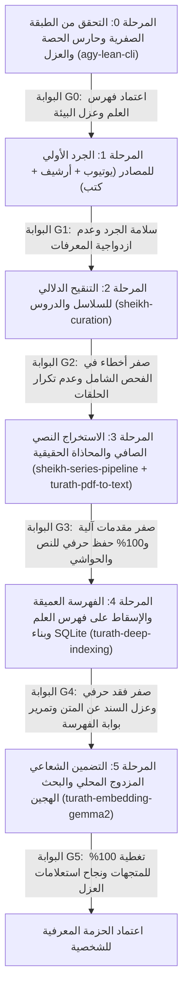

## القواعد الحاكمة الإلزامية (التدرج الأسي اليدوي وشلال الحسابات)

1. **قاعدة التدرج الأسي والفحص اليدوي الذاتي (`1 -> 10 -> 100 -> 1000`)**:
   1. يُمنع منعاً باتاً معالجة عشرات أو مئات العناصر دفعة واحدة قبل نضج التجربة، ويُمنع الاكتفاء بسكريبتات الفحص الآلي وحدها.
   2. يجب على الوكيل في العناصر العشرة الأولى (`1, 2, 3... 10`) أن ينفذ **عملاً واحداً فقط في كل مرة**، ثم **يتفحص المخرج يدوياً بعينه وبعقله** (وليس بالسكريبتات فحسب)، ويحل المشاكل الجذرية ويحسّن من نفسه ومن كود المهارة وتوجيهاتها بعد كل عمل فردي حتى يصل إلى `10`.
   3. بعد إتقان أول `10` عناصر فردية، يتدرج الوكيل بالدفعات العشرية (`10, 20, 30... 100`) ثم المئوية (`100, 200... 1000`) مع المراجعة اليدوية للعينات وتحسين المهارة في كل محطة.
2. **شلال الحسابات الصارم (`Strict Priority Waterfall: العائلة -> brain -> ram`) وحظر الـ `API Keys`**:
   1. يُحظر تماماً استخدام حساب `medmrf10` (`Ultra`) في أي مهام تفريغ أو معالجة خلفية (مخصص حصراً لتطبيق `Antigravity` الرئيسي).
   2. يُحظر منعاً باتاً استخدام أي مفاتيح `API` خارجية (`Gemini API Keys` أو غيرها) دون إذن صريح من محمد؛ التفريغ يتم حصراً عبر الحسابات المدفوعة، والتضمين يتم محلياً بالكامل.
   3. ترتيب استهلاك الحسابات المدفوعة إلزامي بالتتابع: تُستهلك حصة **العائلة (`mb19, mb10, bm10, medmrfco`)** أولاً بالكامل حتى تفرغ (`429`)، ولا يُلمس حساب **`brain`** إطلاقاً إلا إذا كانت العائلة في حالة تبريد، ولا يُلمس حساب **`ram`** إطلاقاً إلا إذا كانت العائلة و`brain` معاً في حالة تبريد.

## المبادئ المعمارية الأربعة الحاكمة لخط إنتاج المعرفة والموسوعة الديناميكية

1. **الطبقة الصفرية — هوية العلم وفهرسه المعياري العام (`Science Identity & Canonical Taxonomy` — بإشراف واعتماد محمد حصراً)**:
   1. **حظر انفراد الوكيل**: لأن «هوية العلم وفهرسه المعياري» هما أهم ركيزة في العلم كله، **يُمنع منعاً باتاً أن ينفرد الوكيل ببنائهما أو اعتمادهما من تلقاء نفسه** قبل الفهرسة.
   2. يقتصر دور الوكيل في الطبقة الصفرية على جمع المادة الأولية من أمهات المصادر المعتمدة وعرض مسودة «بطاقة هوية العلم» (تعريفه، طبقات أعلامه ومصطلحاتهم، وخريطة متونه وشروحه وحواشيه) و«الفهرس العام المعياري للعلم» على محمد ليراجعها ويحررها ويعتمدها شخصياً قبل إسقاط أي مصدر عليها.
2. **فصل الاستطرادات الجانبية عن صلب العلم (`Cross-Science Digression Routing`)**:
   1. عند تقطيع الكتب والدروس إلى مقاطع موضوعية تحفظ النص الأصلي حرفياً (`0% char loss`)، تُفصل الاستطرادات العلمية أو الفكرية الجانبية التي لا تنتمي للعلم الأصلي للكتاب أو الدرس، ويُوجَّه كل استطراد إلى عقدته المقابلة في العلم الذي ينتمي إليه.
3. **بوابة مقيّم القيمة المضافة (`Delta Evaluator Gate`)**:
   1. يمر كل مصدر جديد على تقييم مقارن يفحص كل عقدة في فهرس العلم لتمييز «الإضافة النوعية الجديدة» (تحرير مسألة، رواية زائدة، تعليل دقيق، جواب إشكال، مثال تطبيقي جديد) عن «المكرر المحفوظ».
4. **تحرير مفهوم عدم التكرار وإحصاء الأقوال العلمية (`Statistical Opinion Tracking vs. Verbal Fluff Removal`)**:
   1. منع التكرار في الموسوعة يعني طرد الحشو اللفظي المكرر بلا فائدة، أما في مسائل الخلاف العلمي والفقهي فيجب توثيق وإحصاء تكرار الأقوال عبر المصادر لنعرف بدقة من قال بكل قول وحجم انتشاره بين الأئمة والعلماء.

---

# المنسق الشامل لتحويل تراث الشخصية إلى قاعدة معرفة موحّدة (`person-to-knowledge-orchestrator`)

## 1. المهمة والهيكلة العامة

1. تنسق هذه المهارة رحلة بناء المعرفة الكاملة لعالم أو مصنف بدءاً من التحقق من الطبقة الصفرية (بطاقة العلم وفهرسه المعياري المعتمد من محمد) وحصة الحسابات المعزولة، مروراً بفرز وتنقيح السلاسل والكتب، ثم التفريغ النصي الصافي والمحاذاة الصوتية الحقيقية، وصولاً إلى الفهرسة العميقة الموحدة (`USDB v5.7`) والتضمين الدلالي المحلي المزدوج.
2. تخضع كل مرحلة لبوابة تحقق صارمة (`G0` إلى `G5`)؛ ولا يجوز الانتقال إلى المرحلة التالية إلا بعد اجتياز البوابة الحالية بـ `0` أخطاء حرجة (`0 P0 errors`) مع الفحص اليدوي المتدرج (`1 -> 10 -> 100 -> 1000`).

---

## 2. هيكل مساحة العمل القياسي (`$TURATH_ROOT/workspaces/<person_id>/`)

1. تُحفظ جميع مخرجات خط الإنتاج للشخصية `<person_id>` في شجرة مجلدات معيارية واضحة:
   1. الملف `pipeline_state.json`: سجل حالة المراحل ونتائج البوابات (`G0..G5`) للاستئناف الآمن.
   2. المجلد `00_quota/`: يضم `quota_guard_report.json` لتوثيق حالة الحصة وفق شلال الحسابات وعزل البيئة.
   3. المجلد `01_discovery/`: يضم `<person_id>_raw.json` لجرد المصادر الأولية (قوائم يوتيوب، حزم أرشيف، والكتب).
   4. المجلد `02_curated/`: يضم `<person_id>.json` وقاعدة `curated.db` ومجلدات السلاسل `series/<person_id>/sXXX/_meta.json`.
   5. المجلد `03_extracted/`: يضم مساري النصوص الصافية:
      1. المسار `series/<person_id>/sXXX/`: ملفات الدروس المفرغة `.txt` وملفات المحاذاة الصوتية الحقيقية `.align.json` وملفات `.meta.json`.
      2. المسار `books/<book_slug>/`: مخرجات الكتب المستخرجة بلا فقد حرفي (`book_matn.txt`, `footnotes.json`, `pages_preflight.json`, `adapter_manifest.json`).
   6. المجلد `04_knowledge_db/`: يضم قاعدة المعرفة الموحدة `<person_id>_objects.sqlite` وملفات الفهرسة المدمجة وتقارير البوابات (`gate_report_books.json`, `gate_report_lectures.json`).
   7. المجلد `05_reports/`: يضم تقرير التدقيق الآلي `orchestration_audit_report.json` والتقرير التنفيذي `ORCHESTRATION_REPORT.md`.

---

## 3. المراحل الست وبوابات التحقق الصارمة (`G0` إلى `G5`)

### المرحلة 0 — الطبقة الصفرية وحارس الحصة والعزل (`agy-lean-cli` + `agy-multi-account`)
1. **الإجراء**:
   1. التأكد من وجود «بطاقة هوية العلم» و«الفهرس العام المعياري للعلم» المعتمدين من محمد للعلم المستهدف قبل البدء.
   2. فحص جاهزية الحسابات وفق شلال الأولويات (`العائلة -> brain -> ram`) عبر `$SKILLS_DIR/agy-multi-account` والتحقق من عزل بيئة التشغيل عبر `$SKILLS_DIR/agy-lean-cli/scripts/agy_lean.py`.
2. **البوابة الصارمة `G0`**:
   1. اعتماد الطبقة الصفرية للعلم المستهدف من محمد شخصياً.
   2. توفر حصة آمنة (`>= 20.0%`) في الحساب النشط ضمن الشلال المعتمد دون المساس بحساب `medmrf10`.
   3. ثبوت العزل الكامل لبيئة `HOME` الخفيفة (`isolated == True` مع `0` خوادم `MCP` و`0` إضافات محملة في الخلفية).

### المرحلة 1 — الجرد الأولي متعدد المصادر (`Discovery Intake`)
1. **الإجراء**:
   1. جمع وتوحيد مصادر الشخصية من القنوات وقوائم التشغيل، وحزم `Archive.org`، والفهارس الموثقة، والكتب المؤلفة أو المشروحة في ملف `01_discovery/<person_id>_raw.json`.
2. **البوابة الصارمة `G1`**:
   1. وجود ملف `01_discovery/<person_id>_raw.json` ومطابقته للمخطط القياسي (`person_id`, `sheikh_name`, `playlists`, `videos`, `archive_items`, `books`, `stats`).
   2. خلو قائمة المصادر من المعرفات التالفة أو الفارغة، والتحقق اليدوي من عينة المصادر المكتشفة ومطابقتها الفردية للشخصية المستهدفة.

### المرحلة 2 — التنقيح والفرز الدلالي للسلاسل (`sheikh-curation`)
1. **الإجراء**:
   1. تشغيل أدوات الفرز والتنقيح في `$SKILLS_DIR/sheikh-curation` على `01_discovery/<person_id>_raw.json` لإنتاج `02_curated/<person_id>.json` و`02_curated/curated.db` وملفات `02_curated/series/<person_id>/sXXX/_meta.json`.
2. **البوابة الصارمة `G2`**:
   1. اجتياز الفاحص العميق `$SKILLS_DIR/sheikh-curation/scripts/deep_scanner_all.py` بنتيجة `0` عيوب (`scanner_flaws_total == 0`).
   2. اجتياز المدقق الشامل `$SKILLS_DIR/sheikh-curation/scripts/global_audit.py` برمز خروج `0` ونتيجة `"0 errors"`.
   3. انعدام تكرار أي `video_id` عبر جميع السلاسل النشطة والمحاضرات المستقلة.

### المرحلة 3 — الاستخراج النصي المزدوج والمحاذاة الحقيقية (`sheikh-series-pipeline` + `turath-pdf-to-text`)
1. **المسار 3-أ (السلاسل الصوتية والمرئية)**:
   1. تفريغ الدروس عبر `$SKILLS_DIR/sheikh-series-pipeline` بالتدرج المعتمد (`1 -> 10 -> 100`) وتوليد محاذاة صوتية حقيقية بالكلمة (`.align.json`) عبر محرك `CTC` الفعلي (ويُحظر توليد محاذاة وهمية أو تقديرية).
   2. تطهير النصوص من أي مقدمات أو خواتيم آلية عبر `$SKILLS_DIR/sheikh-series-pipeline/scripts/sanitize_preamble.py`، وتحديث حقول `transcribed_count` و`aligned_count` و`has_transcript` في `_meta.json` و`curated.db`.
2. **المسار 3-ب (الكتب المصورة والنصية)**:
   1. استخراج نصوص الكتب والحواشي عبر `$SKILLS_DIR/turath-pdf-to-text` وتحويلها عبر `$SKILLS_DIR/turath-pdf-to-text/scripts/pdf_to_preflight_adapter.py` بكامل صفحات الكتاب دون أي اقتطاع أو بتر.
3. **البوابة الصارمة `G3`**:
   1. خلو جميع ملفات `.txt` من أي مقدمات أو عبارات دردشة آلية (`strip_preamble_and_header(text)[1] == []`) ووجود محتوى عربي تام.
   2. ثبوت المحاذاة الصوتية الحقيقية (`.align.json`) غير المصطنعة للدروس المستهدفة.
   3. تحقيق حفظ حرفي بنسبة `100.0%` في `adapter_manifest.json` لكل كتاب (`status == "PASS"`, `body_char_loss == 0`, `footnotes_char_loss == 0`, `retention_pct == 100.0`).

### المرحلة 4 — الفهرسة العميقة الموحدة وبناء قاعدة الكيانات (`turath-deep-indexing`)
1. **الإجراء**:
   1. فهرسة الكتب والدروس تحليلياً بالتدرج (`1 -> 10 -> 100`) وإسقاط كل مقطع على عقدته في «الفهرس العام المعياري للعلم» مع فصل الاستطرادات الجانبية وتقييم القيمة المضافة (`Delta`).
   2. دمج وتدقيق الكتب عبر `$SKILLS_DIR/turath-deep-indexing/scripts/merge_round.py` والدروس عبر `$SKILLS_DIR/turath-deep-indexing/scripts/ytb_to_usdb_intake.py` (ويُحظر تماماً استخدام قوالب نصية ثابتة أو ملخصات آلية صورية).
   3. بناء قاعدة البيانات الموحدة `04_knowledge_db/<person_id>_objects.sqlite` عبر `$SKILLS_DIR/turath-deep-indexing/scripts/build_objects_sqlite.py`.
2. **البوابة الصارمة `G4`**:
   1. اجتياز `gate_report_books.json` و`gate_report_lectures.json` بحالة `"PASS"` و`0` أخطاء حرجة (`total_p0_errors == 0`).
   2. تحقيق `chars_lost == 0` (`expected_raw_chars == actual_passage_chars`) داخل قاعدة `SQLite` عبر جميع الكتب والدروس.
   3. العزل التام بين الطبقات: `0` تسرب لرواة الإسناد (`source_layer='isnad'`) في استعلامات طبقة المتن (`matn`)، و`0` تسرب لتواريخ وفيات الرواة (`event_layer='transmission'`) في استعلامات الأحداث التاريخية (`historical`).

### المرحلة 5 — التضمين الشعاعي المزدوج المحلي والتحقق من البحث الهجين (`turath-embedding-gemma2`)
1. **الإجراء**:
   1. تشغيل التضمين المحلي الفعلي عبر `$SKILLS_DIR/turath-embedding-gemma2/scripts/embed_corpus_gemma2.py` على قاعدة `04_knowledge_db/<person_id>_objects.sqlite` لتوليد متجهات المتن (`vec_matn_blob`) ومتجهات المفهوم (`vec_concept_blob`) في جدولي `passage_embeddings` و`gem_embeddings`.
   2. تشغيل فحوص البحث الهجين عبر `$SKILLS_DIR/turath-embedding-gemma2/scripts/hybrid_search.py` في أوضاع `hybrid` و`matn` و`concept` و`fts` مع فلاتر الكيانات والطبقات.
2. **البوابة الصارمة `G5`**:
   1. اكتمال التضمين بنسبة `100%` لجميع المقاطع (`passages`) والقواعد العلمية (`science_gems`).
   2. مطابقة طول كل متجه ثنائي (`BLOB`) لـ `dim * 4` بايت (`3072` بايت لبعد `768` من نوع `float32`) وتطبيع `L2 norm` بقيمة `1.0 ± 1e-3`.
   3. خلو جميع نصوص `embed_concept_text` من رموز الترضية المدمجة (`HONORIFIC_RANGE_RE`) ومن سلاسل الإسناد.
   4. نجاح استعلامات التحقق الهجين وعزل طبقة `person_layer="matn"` عن `isnad`.

---

## 4. الممنوعات الهندسية الصارمة (`Strict Anti-Patterns`)

1. **حظر تجاوز البوابات أو تزييف البيانات**: يُمنع منعاً باتاً توليد ملخصات أو قواعد أو طوابع زمنية (`CTC`) صورية بقوالب نصية ثابتة لتمرير بوابات الفحص.
2. **حظر الاقتطاع الجزئي للكتب**: يُمنع بتر الكتب عند عدد أحرف معين لتسريع التشغيل؛ بل يُعالج الكتاب كاملاً مع التدرج في الفهرسة (`1 -> 10 -> 100`).
3. **حظر فقدان أي حرف (`0% Character Loss`)**: لا يُسمح بضياع حرف واحد من المتن أو الحواشي أو تفريغ الدرس عند التقطيع والدمج في `SQLite`.
4. **حظر خلط السند بالمتن**: يجب دائماً وسم رواة الإسناد (`حدثنا`, `أخبرنا`) بـ `source_layer="isnad"` وتواريخ الوفيات (`ت 310 هـ`) بـ `event_layer="transmission"`.

---

## 5. المراجع التفصيلية (`References`)

1. عقود المراحل والمخططات القياسية: [01-stage-contracts-and-schemas.md](references/01-stage-contracts-and-schemas.md)
2. أدلة معالجة الأعطال والاسترداد: [02-failure-playbooks-and-recovery.md](references/02-failure-playbooks-and-recovery.md)
3. قائمة التحقق الشاملة من الطرف إلى الطرف: [03-end-to-end-verification-checklist.md](references/03-end-to-end-verification-checklist.md)
4. مرجع البوابات والتنسيق الشامل: [01-end-to-end-orchestration-and-gates.md](references/01-end-to-end-orchestration-and-gates.md)
