# 11 · المعمارية الهجينة v5.0: تفريغ السيرفر (VPS) + جسر Opus 12kbps VoIP + محاذاة الماك (Apple Silicon MPS fp16 مع طيّ الصمت)

## لماذا هذا المرجع (الإصدار الخامس `v5.0`)
في الإصدارات السابقة (`v2`–`v4.2`) كان تشغيل خط السلاسل يتم إما بالكامل على الخادم (`--target vps`) حيث تستغرق المحاذاة الصوتية (`extract_emissions.py` على معالج CPU) نحو **20–31 دقيقة لكل درس**، أو بالكامل على الماك (`--target mac`) مما يربط التفريغ النصي الطويل بجلسة الماك المحلية.

يقدّم الإصدار الخامس (**`v5.0 — Hybrid VPS Transcription + Opus 12kbps VoIP Bridge + Mac Apple Silicon MPS fp16 Silence-Compacted Alignment`**) معمارية هجينة موزّعة تجمع أفضل ما في البيئتين في خط إنتاج واحد متصل ٢٤/٧:
1. **الخادم (`hermes-vps`)** يتولى التنزيل والتفريغ النصي الكثيف عبر `agy_transcribe.py` (`gemini-3.8-flash-high`) مرتّباً من السلاسل الأصغر إلى الأكبر (`333` سلسلة · `7,383` درساً)، مع دعم روابط `Archive.org` المباشرة وحارس الكوتة الحيّ.
2. **جسر الصوت فائق الضغط (`Opus 12kbps VoIP Bridge`)** يحوّل الصوت فور تفريغه (وقبل حذف `.mp3` المؤقت) إلى ملف `.opus` بحجم **~3 MB لكل ساعة صوتية**، مما يقضي نهائياً على عنق زجاجة الشبكة بين السيرفر والماك.
3. **الماك (`Apple Silicon M1 Pro MPS`)** يعمل كخدمة نظام دائمة (`LaunchAgent` مع `caffeinate -i`) تسحب ملفات `.opus` مسبقاً في الخلفية وتحاذيها بدقة `fp16` مع طيّ الصمت (`plan_silence` + `compact_wave` + `unpad_emissions`) بسرعة **38× إلى 49× من الوقت الحقيقي** (`RTF ≈ 0.020–0.026`)، ثم تعيد `.align.json` للسيرفر وتزامن الكوتة الحية كل دقيقتين.

---

## ١) المخطط المعماري الشامل لخطّ الإنتاج الهجين (`v5.0`)

```mermaid
flowchart TD
    subgraph VPS["الطبقة ١ و ٢: السيرفر (hermes-vps)"]
        Q["transcribe_selected_smallest_first.py\n(333 سلسلة · 7,383 درساً · الأصغر فالأكبر)"]
        QG["حارس الكوتة الحي (_is_quota_safe_for_background)\n5h >= 15% | Weekly >= 25% (>12h)"]
        DL["download_lesson_audio()\nYouTube (mirath-audio / yt-dlp) + Archive.org (direct_url)"]
        TR["agy_transcribe.py (gemini-3.8-flash-high)\nتقطيع صامت >15د + strip_preamble_and_header()"]
        FD["vps_align_feeder.py\n(تغذية الدروس المفرغة سابقاً)"]
        BR["/root/workspace/align-bridge/ready/\n<sheikh>__<series>__<stem>.opus (16kHz mono 12kbps VoIP ~3MB/h)\n+ .job.json"]

        Q --> QG --> DL --> TR
        TR -->|"تحويل فوري قبل حذف .mp3"| BR
        FD -->|"تحويل الدروس القديمة غير المحاذاة"| BR
    end

    subgraph MAC["الطبقة ٣: الماك (Apple Silicon M1 Pro MPS — LaunchAgent)"]
        PF["prefetch_worker() × 2\nسحب مسبق عبر SSH Multiplexing إلى /tmp/mac_align_spool\n(MAC_ALIGN_PREFETCH=6)"]
        SAN["strip_preamble_and_header()\nتطهير فوري للنص قبل المحاذاة"]
        SC["طيّ الصمت: plan_silence() + compact_wave()\nحذف الفجوات الصامتة وإبقاء 0.15ث هامشاً"]
        MPS["emissions_torch() على MPS (fp16, batch=3)\nتحميل النموذج مرة واحدة في الذاكرة"]
        UNP["unpad_emissions()\nإعادة نفخ المصفوفة إلى الإطارات الأصلية T_orig بدقة 20ms"]
        VIT["ctc_pure_align.align_one_file()\nSliding-Horizon Viterbi v4.2"]
        UP["upload_and_finalize()\nرفع .align.json + تحديث .meta.json + تنظيف الجسر"]
        TH["تخفيف الحمل الحراري والذاكرة\ntorch.mps.empty_cache() + gc.collect() + نوم 3.5ث"]
        QS["quota_sync_worker()\nمزامنة الكوتة كل 120ث إلى live_quota.json"]

        BR ==>|"SCP (~0.5s/درس)"| PF
        PF --> SAN --> SC --> MPS --> UNP --> VIT --> UP --> TH
        UP ==>|"كتابة .align.json وحذف .opus"| VPS
        QS -.->|"كل دقيقتين"| QG
    end
```



---

## ٢) الطبقة الأولى على السيرفر (`hermes-vps`): التفريغ المرتّب، دعم `Archive.org`، وحارس الكوتة الحي

### أ) الترتيب التصاعدي من الأصغر إلى الأكبر (`scripts/transcribe_selected_smallest_first.py`)
- يقرأ قائمة الاختيارات المعتمدة (`333` سلسلة تضم `7,383` درساً) ويفهرس كل التفريغات الصالحة الموجودة في `/root/workspace/ytb` (سواء بمعرّفات يوتيوب ذات الـ11 حرفاً أو معرّفات `archive__*`).
- يرتّب السلاسل تصاعدياً حسب: `(عدد الدروس المتبقية rem_count, إجمالي دروس السلسلة total_count, المدة الزمنية المتبقية rem_dur)` بحيث تُنجز السلاسل القصيرة والمتوسطة أولاً وتدخل طابور المحاذاة فوراً.
- يعمل بتوازي مضبوط (`SERIES_WORKERS=4` × `CHUNK_WORKERS=4`) مع حارس ذاكرة استباقي `wait_for_safe_ram()` يشترط توفر `MemAvailable >= 1600 MB` قبل إطلاق أي سلسلة جديدة، إضافةً إلى أقفال النواة العالمية (`_global_agy_slot` في `/tmp/agy_slot_00..19.lock`) وتنظيف قواعد بيانات جلسات `agy` المؤقتة فور انتهاء كل نداء (`_cleanup_agy_conv_db`).

### ب) دعم التنزيل المباشر من `Archive.org` والروابط المباشرة (`download_lesson_audio`)
- يدعم `agy_transcribe.py` تمرير `direct_url` من حقل `url` في `_meta.json`.
- إذا كان الرابط ينتمي إلى `archive.org/` أو ينتهي بامتداد صوتي مباشر (`.mp3`, `.m4a`, `.wav`, `.ogg`, `.opus`)، ينزّله مباشرةً عبر `curl -fL --retry 3` إلى ملف مؤقت `.part.mp3` ويتحقق من سلامته ومدته عبر `is_valid_audio_file()` قبل اعتماده ذرياً (`os.replace`)، متجاوزاً الحاجة إلى `yt-dlp` لملفات الأرشيف.
- للدروس المرفوعة على يوتيوب، يستخدم `/usr/local/bin/mirath-audio` أولاً ثم `yt-dlp` كبديل احتياطي، مع استكمال تحويل أي ملف `.webm` مكتمل من محاولة سابقة دون إعادة تنزيله.

### ج) حارس الكوتة الحي (`_is_quota_safe_for_background`)
قبل حجز أي خانة تنفيذ في `_global_agy_slot()`، يفحص `agy_transcribe.py` لقطة الكوتة الحية (`/root/workspace/ytb-build/live_quota.json` أو `/tmp/agy_quota_snapshot.json` بشرط ألا يتجاوز عمرها 30 دقيقة `1800s`):
1. **حماية نافذة الـ5 ساعات (`5-Hour Window Guard`):** إذا كانت نسبة الكوتة المتبقية `remainingPercentage < 0.15` (أقل من `15%`) أو `isExhausted == True`، يتوقف عمال الخلفية مؤقتاً (`sleep 60s`) لحماية احتياطي **`10%` صافٍ** للمالك والوكيل الرئيسي التفاعلي.
2. **حماية الكوتة الأسبوعية (`Weekly Quota Guard`):** إذا كان الوقت المتبقي على التجديد `reset_hours > 12.0` ساعة (أي خارج آخر 12 ساعة من الأسبوع) وهبطت النسبة المتبقية إلى `remainingPercentage <= 0.25` (`<= 25%`)، يتوقف عمال الخلفية مؤقتاً للحفاظ على ربع الكوتة الأسبوعية، بينما يُسمح باستنفادها فوق حد الـ15% في آخر 12 ساعة قبل التجديد الأسبوعي.

---

## ٣) الطبقة الثانية (`Opus 12kbps VoIP Bridge`): القضاء على عنق زجاجة الشبكة

### المشكلة السابقة والحل الهندسي
كان نقل ملفات `.mp3` أو `.wav` الخام بين السيرفر والماك يستهلك عشرات الميغابايتات لكل درس ويُبطئ شريحة `M1 Pro`. وبما أن نموذج المحاذاة `mms-300m-1130-forced-aligner` يعمل داخلياً على تردد `16kHz mono` ويركّز على حزمة الكلام البشري، فإن ترميز الصوت بصيغة **Opus 12kbps VoIP** (`-ac 1 -ar 16000 -c:a libopus -b:a 12k -compression_level 0 -application voip`) ينتج ملفاً بحجم **~3 MB إلى 5 MB لكل ساعة صوتية** مع تطابق تام في إطارات الانبعاثات.

### مسارا التغذية إلى `/root/workspace/align-bridge/ready/`
1. **التحويل الفوري داخل `agy_transcribe.py` (Zero-Redownload Path):**
   - فور نجاح تفريغ الدرس وكتابة `<base>.txt` و`<base>.meta.json` على اللينكس، وقبل حذف ملف `.mp3` المؤقت من قرص السيرفر، يتحقق `agy_transcribe.py` من عدم وجود `.align.json` ومن أن عدد ملفات `.opus` في الجسر أقل من سقف الأمان (`< 120` ملفاً).
   - يحوّل `.mp3` الموجود محلياً في ثوانٍ معدودة إلى `<sheikh>__<series>__<base>.opus` ويكتب ملف وصف المهمة `.job.json` ذرياً، ثم يحذف `.mp3` الأصلي لتوفير مساحة قرص السيرفر.
2. **مغذّي الدروس المفرغة سابقاً (`scripts/vps_align_feeder.py`):**
   - يعمل في الخلفية لخدمة الدروس التي فُرّغت قبل تفعيل التحويل الفوري وليس لها `.align.json` بعد.
   - يرتّب السلاسل بنفس ترتيب `transcribe_selected_smallest_first.py` (الأصغر فالأكبر)، ويحافظ على نافذة جاهزة (`ALIGN_MAX_BUFFER = 40` درساً) في `/root/workspace/align-bridge/ready/`، وينظّف تلقائياً أي مهمة ظهر لها ملف `.align.json` صالح (`cleanup_completed_in_bridge`).

### مخطط ملف المهمة (`.job.json`)
```json
{
  "key": "ahmed-alsayed__row-1012__001_dQw4w9WgXcQ",
  "vid": "dQw4w9WgXcQ",
  "stem": "001_dQw4w9WgXcQ",
  "sheikh": "ahmed-alsayed",
  "row": "row-1012",
  "txt_path": "/root/workspace/ytb/ahmed-alsayed/row-1012/001_dQw4w9WgXcQ.txt",
  "dur_s": 1842.5,
  "opus_bytes": 2764800,
  "created_at": 1792281000.0
}
```

---

## ٤) الطبقة الثالثة على الماك (`scripts/mac_align_fleet.py`): خدمة `LaunchAgent`، طيّ الصمت بدقة `fp16`، وتخفيف الحمل الحراري

### أ) التشغيل كخدمة نظام دائمة (`LaunchAgent` + `caffeinate -i`)
يعمل محرك المحاذاة على الماك كخدمة مستمرة (`~/Library/LaunchAgents/com.mohamed.mac-align-fleet.plist`) تعيد تشغيل نفسها تلقائياً عند الإقلاع أو عند أي توقف (`KeepAlive=true`)، مغلّفةً بـ`/usr/bin/caffeinate -i` لمنع نوم النظام أثناء عمل البطاقات الصوتية، مع تفعيل الوضع غير المتصل لكاش HuggingFace (`HF_HUB_OFFLINE=1` و`TRANSFORMERS_OFFLINE=1`) عند اكتمال أوزان `MahmoudAshraf/mms-300m-1130-forced-aligner` محلياً بحيث يُحمَّل النموذج في **~1.5 ثانية** مرة واحدة فقط طوال عمر العملية.

### ب) السحب المسبق عبر SSH المدمج (`prefetch_worker`)
- يعمل خيطا سحب مسبق (`MAC_ALIGN_PREFETCH_THREADS=2`) للحفاظ على `MAC_ALIGN_PREFETCH=6` دروس جاهزة دائماً في `/tmp/mac_align_spool`.
- يستخدم اتصالات SSH مدمجة (`ControlMaster=auto`, `ControlPath=/tmp/ssh-mux-align-%h`, `ControlPersist=600`) لسحب `.opus` و`.txt` في أقل من ثانية للدرس الواحد، فلا تنتظر شريحة `M1 Pro` الشبكة إطلاقاً.

### ج) تطهير الديباجة (`strip_preamble_and_header`) قبل المحاذاة
قبل فكّ الصوت أو حساب التوكنات، يمرّر `mac_align_fleet.py` نصّ الدرس عبر `strip_preamble_and_header()` لإزالة أي مقدمة لاتينية متسربة (`LATIN_PREAMBLE`) أو ترويسة بيانات وصفية غير منطوقة (`METADATA_HEADER` مثل `الشيخ:` / `السلسلة:` / `[شارة إنشادية]`) وتحديث نسخة النص المحلية حتى لا تفسد محاذاة أول 60 ثانية من المحاضرة.

### د) معادلات طيّ الصمت المحافظ وإعادة النفخ (`plan_silence` → `compact_wave` → `emissions_torch fp16` → `unpad_emissions`)
لتسريع استخراج الانبعاثات على شريحة `mps` بدقة `fp16` دون أي إخلال بالتوقيت الزمني للمللي ثانية ودون قصّ الحروف المهموسة أو أصوات السائلين:
1. **`plan_silence(wave_np, sr=16000, min_sil=0.65, keep=0.20, frame=320, rel_db=9.5, win_s=8.0, abs_db=-55.0)`:**
   - يقسّم الموجة الصوتية إلى إطارات بطول `20ms` (`frame = 320` عينة عند `16kHz`)، ويحسب طاقة `RMS` بالديسيبل لكل إطار.
   - يحسب وسيط الطاقة المحلي المتدرّج (`rolling median` بنافذة `±8.0s`) ويعدّ الإطار صامتاً إذا انخفض بـ`rel_db = 9.5 dB` تحت الوسيط المحلي **أو** انخفض تحت أرضية الصمت المطلقة `abs_db = -55.0 dB` (بحيث تُطوى المقاطع الصامتة الطويلة كلياً حتى لو هبط الوسيط المحلي فيها إلى `-100 dB`).
   - لكل فجوة صمت متصلة لا تقل مدتها عن `min_sil = 0.65s` (`32` إطاراً)، يُبقي هامش أمان `keep = 0.20s` (`10` إطارات) عند الطرفين ويعلّم الوسط بـ`keep_mask = False`.
2. **`compact_wave(wave_np, keep_mask, frame=320)`:**
   - إذا كانت نسبة الصمت القابل للطيّ `pct >= 1.5%`، يقتطع الإطارات المحذوفة ويبني موجة صوتية مضغوطة متصلة مع مصفوفة الفهارس الأصلية `idx_map = np.flatnonzero(keep_mask)` حيث يمثّل كل عنصر في `idx_map` موضع الإطار المحتفظ به في المصفوفة الأصلية ذات الطول `n_frames = len(wave_np) // 320`.
3. **`emissions_torch(model, wav_in, device='mps', dtype=torch.float16, window=30.0, context=2.0, batch_size=3)`:**
   - يمرّر الموجة المضغوطة فقط عبر نموذج `mms-300m` على `mps` بدقة `fp16` ودفعة `batch_size=3` مع تفريغ اللوغاريتمات فوراً إلى ذاكرة CPU بدقة `float32`.
4. **`unpad_emissions(em_compact, idx_map, n_frames, blank_fill=-10.0, star_col=...)`:**
   - ينشئ مصفوفة بالحجم الأصلي الكامل `(n_frames, C)` مملوءة بقيمة `blank_fill = -10.0` مع تصفير عمود `<blank>` (`full[:, 0] = 0.0`) وعمود `<star>` (`full[:, star_col] = 0.0`).
   - يعيد إسقاط الانبعاثات المحسوبة في مواضعها الزمنية الأصلية بدقة: `full[idx_map[:k]] = em_compact[:k]`. بذلك تبقى أبعاد المصفوفة النهائية `T == n_frames` مطابقةً تماماً للصوت الأصلي قبل الطيّ، وتظل خطوة الإطار `stride = 20.0ms` (`50 fps`) ثابتة بلا أي انزياح زمني.

### هـ) القاعدة الإلزامية لحارس `< 95.0%` (`< 95.0% Auto-Retry & Root-Cause Investigation Guard`)
تُعدّ أي محاذاة تقل فيها نسبة الكلمات المنطوقة المحاذاة صوتياً (`spoken_align_coverage`) عن **`95.0%`** (`MIN_ACCEPTABLE_ALIGN_PCT = 95.0`) حالة شاذة تستوجب المعالجة والتشخيص الآلي الفوري داخل `mac_align_fleet.py`:
1. **إعادة المحاولة التلقائية بدون طيّ الصمت (`Full-Wave Auto-Retry`):**
   - إذا خرجت `spoken_align_coverage < 95.0%` وكان طيّ الصمت مفعّلاً (`idx_map is not None`)، يعيد `mac_align_fleet.py` فوراً استخراج الانبعاثات من الموجة الكاملة بدون أي طيّ صمت (`torch.from_numpy(data)`), ويعيد تشغيل `ctc_pure_align.align_one_file` ويعتمد النتيجة ذات التغطية الأعلى.
2. **التشخيص الجذري الآلي (`diagnose_low_coverage`):**
   - إذا بقيت التغطية `< 95.0%` بعد إعادة المحاولة على الموجة الكاملة، يحلّل `diagnose_low_coverage(rep, dur)` السبب الجذري ويسجّله في `mac_align_fleet.log` و`<stem>.meta.json`:
     - **`TEXT_HALLUCINATION_OR_CHUNK_REPEAT`:** وجود كتل كلمات متصلة بلا أثر صوتي (`unaligned_clusters` بطول `>= 40` كلمة أو استيفاء كثيف نتيجة هلوسة مقطع صامت أو تكرار حدود المقاطع).
     - **`DEAD_SILENCE_TAIL_OR_TRUNCATION`:** انتهاء الكلام الفعلي في الصوت مبكراً (`audio_span_pct < 80%`) بسبب ذيل صمت رقمي في الفيديو الأصلي (حيث يتوقف `ctc_pure_align.py` تلقائياً فور نفاد الأحداث الصوتية `ev_after == 0`، ويتخطى `agy_transcribe.py` المقاطع الصامتة عبر `_is_dead_silent_chunk` عند `max_volume <= -48 dB`).
     - **`ACOUSTIC_MISMATCH_OR_DUBBED_TRACK`:** عدم تطابق صوتي واسع أو مسار مدبلج إنجليزياً؛ ولمنعه من الجذور يفرض `vps_align_feeder.py` و`agy_transcribe.py` اختيار المسار العربي الأصلي في `yt-dlp` عبر `[language^=ar]` و`[format_note*=original]`.

### و) تخفيف الحمل الحراري وإدارة ذاكرة الماك (`Thermal & Memory Throttling`)
لحماية جهاز `MacBook Pro M1 Pro` من الاختناق الحراري (`Thermal Throttling`) أو تضخم ذاكرة `MPS` أثناء العمل المتواصل لأيام:
- **`MAC_ALIGN_BATCH_SIZE = 3`** (بدل 8 أو 16) لتقليل ذروة استهلاك GPU لكل نافذة.
- **`MAC_ALIGN_PREFETCH = 6`** لتقليل استهلاك `/tmp/mac_align_spool`.
- **تنظيف فوري بعد كل درس:** استدعاء `torch.mps.empty_cache()` متبوعاً بـ`gc.collect()` داخل كتلة `finally` بعد كل درس، بالإضافة إلى تفريغ الكاش كل 8 خطوات داخل `emissions_torch()`.
- **استراحة تبريد إجبارية (`MAC_ALIGN_COOLDOWN_S = 3.5` ثانية):** توقّف `time.sleep(3.5)` بين كل درس والذي يليه، مما يُبقي حرارة الشريحة منخفضة مع الحفاظ على سرعة إجمالية تبلغ **~38× إلى 49× من الوقت الحقيقي** (درس 30 دقيقة يُحاذى بالكامل في **~36 إلى 45 ثانية**).

### ز) خيط مزامنة الكوتة الحية (`quota_sync_worker`)
- يعمل كخيط خلفي دائم (`daemon=True`) داخل `mac_align_fleet.py`.
- يستدعي كل **120 ثانية** أداة `/Users/macm1pro/.hermes/node/bin/antigravity-usage quota --json --all-models` محلياً على الماك، ويكتب النتيجة ذرياً في `/tmp/agy_quota_snapshot.json`، ثم ينسخها عبر اتصال SSH المدمج إلى السيرفر في `/root/workspace/ytb-build/live_quota.json`.
- يضمن هذا الخيط أن حارس الكوتة على السيرفر (`_is_quota_safe_for_background` في `agy_transcribe.py`) يقرأ دائماً الاستهلاك الفعلي الحيّ لحساب Antigravity ويتوقف فوراً عند اقتراب الكوتة من حدود الأمان.

---

## ٥) بوابة الفحص الحتمية للإصدار الخامس (`scripts/test_pipeline_v5_gates.py`)

للتحقق الفوري والحتمي من سلامة جميع مكونات المعمارية الهجينة `v5.0` قبل أو أثناء التشغيل، نفّذ:

```bash
python3 /Users/macm1pro/REPOS/SKILLS/sheikh-series-pipeline/scripts/test_pipeline_v5_gates.py
```

تختبر البوابة خمس مراحل صارمة:
1. **`Gate 1 (Syntax & Component Integrity)`:** فحص شجرة `AST` ووجود الدوال والثوابت المحورية في `agy_transcribe.py` (`download_lesson_audio` مع `direct_url`, `_is_quota_safe_for_background`, `_is_dead_silent_chunk`, `deduplicate_chunk_boundary_overlap`), `sanitize_preamble.py` (`strip_preamble_and_header`, `deduplicate_chunk_boundary_overlap`), `vps_align_feeder.py` (`[language^=ar]`), `mac_align_fleet.py` (`plan_silence`, `compact_wave`, `unpad_emissions`, `quota_sync_worker`, `MIN_ACCEPTABLE_ALIGN_PCT`, `diagnose_low_coverage`), `ctc_pure_align.py` (`tighten_word_onsets_against_breath_and_blank`, `align_slice`, `interpolate`), `transcribe_selected_smallest_first.py`, ووجود هذا المرجع `references/11-hybrid-vps-mac-mps-v5.md`.
2. **`Gate 2 (Silence Compaction & Unpadding Math + Preamble Sanitizer)`:** اختبار رياضي فعلي لدوال `plan_silence` (بما فيها طيّ الصمت الرقمي الطويل عبر `abs_db=-55.0`) و`compact_wave` و`unpad_emissions` على موجة صوتية اصطناعية تحوي فجوات صمت طويلة والتأكد من استرجاع الطول الأصلي `T_orig` بدقة الملي ثانية، مع فحص `strip_preamble_and_header` على نصوص ملوثة بمقدمات لاتينية وترويسات وصفية.
3. **`Gate 3 (Quota Guard, <95% Diagnosis Guard & Real .align.json Schema Validation)`:** اختبار `_is_quota_safe_for_background` على حالات الكوتة الحرجة (`5h < 15%`، والأسبوعية `<= 25%` مع `> 12h` مقابل `<= 12h`)، واختبار `diagnose_low_coverage` للحالات الأقل من `95.0%`، والتحقق من مخطط `.align.json` ودوال المحاذاة النقية (`shadow_words_1to1`, `interpolate`).
4. **`Gate 4 (Pre-Speech Breath Onset Tightening Gate — ALIGN-ONSET-BREATH-JUMP)`:** محاكاة التقاط أول حرف من الكلمة التالية على صوت الشهيق في أول السكتة متبوعاً بـ`3.1s` من إطارات `<blank>`، والتأكد من أن `tighten_word_onsets_against_breath_and_blank` يشدّ بداية الكلمة للأمام (`>= 4.05s`) وبمدة طبيعية (`<= 0.85s`) مع منع `interpolate()` من ابتلاع سكتات النفس (`gap > 0.8s`).
5. **`Gate 5 (Chunk-Boundary Overlap Deduplication & Post-Breath Onset Duration Gate)`:** اختبار `deduplicate_chunk_boundary_overlap` على حدود المقاطع المتتالية (`12` دقيقة) للتأكد من إزالة الجمل المكررة عند نقاط القطع مع الحفاظ الكامل `100%` على التكرارات التعبدية المشروعة (`«آمين آمين»`، `«صلى الله عليه وسلم»`)، وفحص سقف مدة الكلمات الطويلة بعد سكتة النفس (`max(0.85, 0.22 * n_chars)`).
