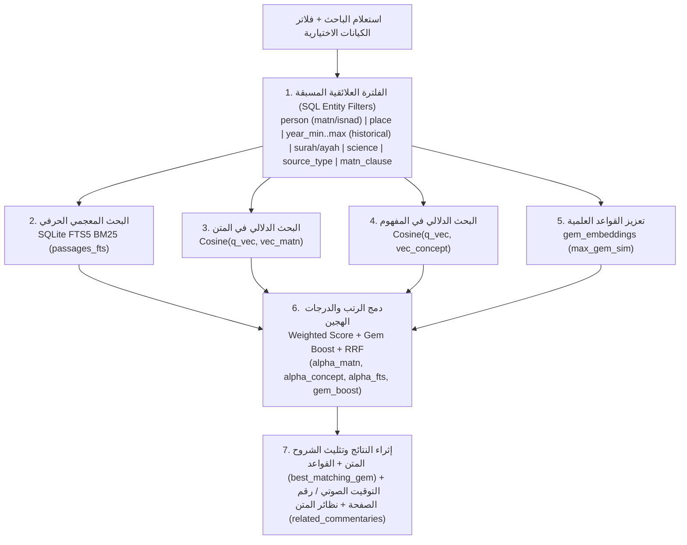

## القواعد الحاكمة الإلزامية (التدرج الأسي اليدوي وشلال الحسابات)

1. **قاعدة التدرج الأسي والفحص اليدوي الذاتي (`1 -> 10 -> 100 -> 1000`)**:
   - يُمنع منعاً باتاً معالجة عشرات أو مئات العناصر دفعة واحدة قبل نضج التجربة، ويُمنع الاكتفاء بسكريبتات الفحص الآلي وحدها.
   - يجب على الوكيل في العناصر العشرة الأولى (`1, 2, 3... 10`) أن ينفذ **عملاً واحداً فقط في كل مرة**، ثم **يتفحص المخرج يدوياً بعينه وبعقله** (وليس بالسكريبتات فحسب)، ويحل المشاكل الجذرية ويحسّن من نفسه ومن كود المهارة وتوجيهاتها بعد كل عمل فردي حتى يصل إلى `10`.
   - بعد إتقان أول `10` عناصر فردية، يتدرج الوكيل بالدفعات العشرية (`10, 20, 30... 100`) ثم المئوية (`100, 200... 1000`) مع المراجعة اليدوية للعينات وتحسين المهارة في كل محطة.
2. **شلال الحسابات الصارم (`Strict Priority Waterfall: العائلة -> brain -> ram`) وحظر الـ `API Keys`**:
   - يُحظر تماماً استخدام حساب `medmrf10` (`Ultra`) في أي مهام تفريغ أو معالجة خلفية (مخصص حصراً لتطبيق `Antigravity` الرئيسي).
   - يُحظر منعاً باتاً استخدام أي مفاتيح `API` خارجية (`Gemini API Keys` أو غيرها) دون إذن صريح من محمد؛ التفريغ يتم حصراً عبر الحسابات المدفوعة، والتضمين يتم محلياً بالكامل.
   - ترتيب استهلاك الحسابات المدفوعة إلزامي بالتتابع: تُستهلك حصة **العائلة (`mb19, mb10, bm10, medmrfco`)** أولاً بالكامل حتى تفرغ (`429`)، ولا يُلمس حساب **`brain`** إطلاقاً إلا إذا كانت العائلة في حالة تبريد، ولا يُلمس حساب **`ram`** إطلاقاً إلا إذا كانت العائلة و`brain` معاً في حالة تبريد.

## الضوابط الهندسية الذهبية للتضمين المحلي والبحث الهجين (`Local Embedding & Hybrid Retrieval Standards`)

1. **الاعتماد الحصري على التضمين المحلي (`100% Local Embedding — Zero External API`)**:
   - يتم التضمين محلياً بالكامل دون استخدام أي مفاتيح `API` خارجية، مع فحص خلو جميع المتجهات من `NaN/Inf` والتطبيع الرياضي `L2` بترميز `float32 BLOB` وتنفيذ تجربة استطلاعية (`1%`) قبل تضمين المدونة الكاملة.
2. **قواعد ما قبل التوليد (تُحفر في صلب المتجه)**:
   - **الترويسة السياقية المحايدة (`Contextual Header`)**: إرفاق ترويسة (`الكتاب | المصنف ووفاته | الباب | الموضع`) لمنع فخ نسبة الأقوال المنقولة وحكايات المذاهب لمؤلف الكتاب.
   - **فصل التخزين الثلاثي (`3-Layer Storage Separation`)**: الفصل بين `source_text` (النص الخام الحرفي)، و`content` (النص المنظف للعرض)، و`embedding_input` (النص المتروس للتضمين)، مع التقطيع بالوحدة العلمية الطبيعية (`350` إلى `600` توكن بتداخل `30` إلى `50` توكناً).
3. **قواعد ما بعد التوليد (البحث الهجين وتوسيع السياق)**:
   - الجمع بين البحث النصي `FTS5 BM25` والمتجهات الدلالية عبر دمج الرتب المتبادلة (`RRF`) متبوعاً بإعادة الترتيب (`Re-ranker`)، والتوسيع السياقي الأبوي (جلب سياق الباب الحاضن للمقطع عند العرض)، وتوليد الوثائق الافتراضية (`HyDE`) لترجمة السؤال المعاصر إلى مصطلحات تراثية، والتصفية بالوسوم المذهبية والزمنية.

# مهارة `turath-embedding-gemma2`: التضمين الشعاعي المزدوج بـ `EmbeddingGemma 2` والاسترجاع الهجين المعرفي

تمثل هذه المهارة **المواصفة الهندسية والمحرك التنفيذي** لطبقة التضمين الشعاعي المزدوج (`Dual-Vector Representation`) والبحث الهجين العلائقي (`Hybrid Search + Relational Entity Filtering`) فوق قواعد بيانات الكيانات الموحدة (`SQLite`) التي تنتجها منظومة `turath-deep-indexing`.

> **ملاحظة تشغيلية:** جميع السكربتات في `scripts/` مكتفية ذاتياً (`Self-Contained`)، وتعمل على `macOS` (`Apple Silicon MPS` / `NumPy`) وخوادم `Linux`، وتدعم التبديل التلقائي بين المحركات الحية (`Ollama` / `SentenceTransformers` / `Google GenAI`) والمحرك المحلي الحتمي المسرّع (`DeterministicArabicGemma2Embedder`) للعمل دون اتصال بالإنترنت (`Offline / Gate Testing`).

---

## 1. الفلسفة المعمارية: لماذا التضمين الشعاعي المزدوج (`Dual-Vector Representation`)؟

تعاني أنظمة الاسترجاع التقليدية أحادية المتجه (`Single-Vector RAG`) في التراث الإسلامي والدروس العلمية من تناقض بنيوي حاد:
1. **فجوة العبارة التراثية مقابل السؤال المعاصر (`Lexical-Conceptual Chasm`):**
   - المتن التراثي يُصاغ بلغة классиكية مكثفة أو بألفاظ الحديث والمتون (مثل: *«المشقة تجلب التيسير»*، *«الواجب العقلي ما لا يتصور في العقل عدمه»*، *«لا ينكر تغير الأحكام بتغير الأزمان»*).
   - الباحث المعاصر قد يبحث **بنص العبارة التراثية حرفياً**، أو يبحث **بسؤال مفهومي معاصر** (مثل: *«ما ضوابط الرخص الشرعية عند المرض والسفر؟»* أو *«أثر تغير العرف والبيئة في الفتوى الفقهية»*).
   - دمج المتن الأصلي والملخص التحليلي في متجه واحد يُضعف دقة المتجه في الحالتين معاً.
2. **تلوث المتجهات برواة الإسناد ورموز الطباعة (`Isnad & Typographical Pollution`):**
   - في كتب الحديث والتراجم والتاريخ، تتكرر أسماء رواة السند (`حدثنا قتيبة بن سعيد عن مالك...`) في آلاف المقاطع؛ فإذا دخلت في متجه المفهوم أو لم تُعزل عن المتن، طغى تشابه السند على موضوع المقطع.
   - كما أن محارف الترضية المدمجة في يونيكود (`\ufd40..\ufd4f` مثل `﵀` و`﵁`) وعلامات الصفحات (`[ص: ١٢٣]`, `صفحة ١٣٧`, `⦗١١٣⦘`) وحواشي `(¬١)` تشوّه تقطيع الكلمات (`Tokenization`) في نماذج التضمين.

لذلك تعتمد هذه المهارة **معمارية المتجهين المستقلين (`Dual-Vector Architecture`)** لكل مقطع (`passage`) ولكل قاعدة علمية (`science_gem`):

| المتجه | الحقل المصدري | الوظيفة الدلالية ومحتواه الدقيق | متى يتصدر في البحث؟ |
| :--- | :--- | :--- | :--- |
| **متجه المتن (`vec_matn`)** | `embed_matn_text` | يُولَّد من النص الأصلي الصافي (`clean_matn`) بعد تجريد سلسلة الإسناد الابتدائي (`isnad_prefix`) والأسانيد الداخلية، وفك محارف الترضية المدمجة (`\ufd40..\ufd4f` و`\ufdfa..\ufdff`) إلى كلمات عربية قياسية، وحذف علامات الصفحات (`[ص: N]`, `صفحة N`, `⦗N⦘`) ورموز الحواشي `(¬N)`. | عند البحث بعبارة تراثية، نص حديث، شاهد، بيت شعري، أو جملة من متن مشروح. |
| **متجه المفهوم (`vec_concept`)** | `embed_concept_text` | يُولَّد من العنوان الفرعي (`sub_heading`) + الملخص التحليلي (`summary`) + الموضوعات (`topics`) + القواعد المصقولة (`polished_rule`) + الأسئلة البحثية (`search_queries`) + أعلام المتن (`source_layer='matn'`) + الأماكن (`places`) + التواريخ التاريخية (`event_layer='historical'`)، **مع الاستبعاد الصارم لرواة الإسناد (`source_layer='isnad'`) وتواريخ النسخ والسماع (`event_layer='transmission'`)**. | عند البحث بسؤال مفهومي معاصر، مسألة فقهية أو عقدية، أو مصطلح تحليلي. |

---

## 2. مخطط تخزين المتجهات في SQLite (`Vector Storage Schema`)

يتكامل محرك `embed_corpus_gemma2.py` مع الجداول الإحدى عشرة القياسية التي يبنيها `build_objects_sqlite.py` في `turath-deep-indexing`، ويضيف إليها جدولَي متجهات مدمجين بصيغة `float32 BLOB` مطبّعة مسبقاً بـ `L2-Norm` (`||v||_2 = 1.0`):

### أ. جدول متجهات المقاطع (`passage_embeddings`):
```sql
CREATE TABLE IF NOT EXISTS passage_embeddings (
    passage_id TEXT PRIMARY KEY,
    model_name TEXT NOT NULL,
    dim INTEGER NOT NULL,
    embed_matn_text TEXT NOT NULL,
    embed_concept_text TEXT NOT NULL,
    vec_matn_blob BLOB NOT NULL,
    vec_concept_blob BLOB NOT NULL,
    matn_norm REAL NOT NULL,
    concept_norm REAL NOT NULL,
    FOREIGN KEY (passage_id) REFERENCES passages(passage_id)
);
```

### ب. جدول متجهات القواعد والدرر العلمية (`gem_embeddings`):
```sql
CREATE TABLE IF NOT EXISTS gem_embeddings (
    gem_id TEXT PRIMARY KEY,
    passage_id TEXT NOT NULL,
    model_name TEXT NOT NULL,
    dim INTEGER NOT NULL,
    embed_matn_text TEXT NOT NULL,
    embed_concept_text TEXT NOT NULL,
    vec_matn_blob BLOB NOT NULL,
    vec_concept_blob BLOB NOT NULL,
    FOREIGN KEY (gem_id) REFERENCES science_gems(gem_id),
    FOREIGN KEY (passage_id) REFERENCES passages(passage_id)
);
```

### ج. تسريع تشابه جيب التمام (`Accelerated Cosine Similarity`):
- بما أن كل متجه مخزن في `vec_matn_blob` و`vec_concept_blob` مطبّع مسبقاً على كرة الوحدة (`||v||_2 == 1.0 ± 1e-5`) بصيغة `float32`، فإن حساب تشابه جيب التمام (`Cosine Similarity`) يختزل إلى عملية ضرب قياسي مباشر (`Dot Product / Matrix-Vector Multiplication`):
  $$\text{cos\_sim}(q, d) = \langle \hat{q}, \hat{d} \rangle = \mathbf{D} \cdot \hat{q}$$
- ينفذ المحرك هذه العملية دفعةً واحدة (`Vectorized MatMul`) عبر `torch` على شريحة `Apple Silicon MPS` أو `CPU`، أو عبر `numpy.matmul` في أقل من ملي ثانية لآلاف المقاطع.

---

## 3. معمارية البحث الهجين (`Hybrid Search + Gem Boost + Matn Triangulation + RRF`)

يدمج محرك `scripts/hybrid_search.py` خمس طبقات استرجاع وتثليث في خط أنابيب واحد:



1. **الطبقة الأولى — الفلترة العلائقية الصارمة والمرنة بالكيانات (`Relational Entity Filters`):**
   - `--person "<اسم العلم>"` مع `--person-layer matn|isnad|any` (**الافتراضي `'matn'`** لمنع تلوث نتائج البحث بالمقاطع التي ورد فيها العلم راوياً في السند فقط!)، مع دعم المطابقة المطبّعة المرنة للألقاب والكنى المعربة (مثل مطابقة `"الترمذي"` أو `"الإمام الترمذي"` لـ `"الإمام أبو عيسى الترمذي"`، ومطابقة `"أبا هريرة"` أو `"أبي هريرة"` لـ `"أبو هريرة رضي الله عنه"`).
   - `--place "<اسم المكان>"` عبر جدولَي `passage_places` و`places` مع تجريد الألقاب الجغرافية (`المكرمة / المنورة / الشريف`) والمطابقة ثنائية الاتجاه.
   - `--year-min <H>` و`--year-max <H>` عبر جدول `events_chronology` مع اشتراط `event_layer = 'historical'` لاستبعاد تواريخ نسخ المخطوطات (`transmission`).
   - `--surah <N>` أو `--ayah <surah:ayah>` عبر جدول `evidences` (يدعم أرقام السور وأسماء السور الـ 114 والأرقام الهندية مثل `2:255` أو `البقرة:255` أو `٢:٢٥٥`).
   - `--science <science>` و`--source-type <book|lecture|course>` عبر جدول `sources`.
   - `--matn-clause <clause_id_or_verbatim>` عبر جدول `matn_triangulation` (يدعم كلاً من رمز الفقرة مثل `AKH:2` أو جزءاً حرفياً من نص المتن المشروح) لاسترجاع جميع الشروح الصوتية والمكتوبة لفقرة المتن الواحدة.
2. **الطبقة الثانية — البحث النصي الحرفي الصامد إملائياً وصرفياً (`Orthographic & Stem-Resilient FTS5 BM25`):**
   - يستعلم من جدول `passages_fts` مع عزل أدوات الاستفهام والكلمات القالبية (`هل، ما حكم، مسألة، ضابط، يجوز`)، وتوليد مجموعات البدائل الإملائية (`أ/إ/آ/ا`, `ة/ه`, `ى/ي`) وبادئات الجذوع الصرفية (`"stem"*`) وحساب درجات `BM25` المعززة بالتطابق الجذعي المطبّع.
3. **الطبقة الثالثة — البحث الدلالي المزدوج وتعزيز القواعد العلمية (`Dual EmbeddingGemma 2 + Science Gems Boost`):**
   - يولّد متجه الاستعلام ببادئة المهمة القياسية: `task: search query | query: {query}`، ثم يحسب `sim_matn` و`sim_concept` عبر ضرب المصفوفات المسرّع.
   - يحسب في الوقت نفسه تشابه الاستعلام مع متجهات القواعد العلمية المستخرجة (`gem_embeddings`) ليمنح كل مقطع درجة `max_gem_sim` و`best_matching_gem`، ويعزز ترتيب المقطع الذي يحوي قاعدة علمية مطابقة لسؤال الباحث (`--gem-boost`)، مع إتاحة البحث المباشر في القواعد عبر `search_gems()` أو `--target gems|both`.
4. **الطبقة الرابعة — التثليث متعدد المصادر عبر الشروح (`Cross-Source Matn Triangulation`):**
   - يربط كل مقطع مسترجع بنظائره في المصادر الأخرى عبر حقل `related_commentaries` (سواء عبر تطابق `explained_matn_clause_id` أو تطابق نص المتن `explained_matn_verbatim`)، فيقترن مقطع الكتاب المحقق (`page_num`) آلياً بشروحه الصوتية المحاذاة بالثانية (`start_sec`, `end_sec`, `youtube_timestamp_url`)، كما تتيح دالة `cross_commentary_search()` (`--target cross_commentary`) استخراج جدول المقارنة الشامل بين الشراح.

---

## 4. الأدوات التنفيذية في المهارة (`scripts/`)

| السكربت | الوظيفة الدقيقة |
| :--- | :--- |
| [`scripts/embed_corpus_gemma2.py`](./scripts/embed_corpus_gemma2.py) | محرك تجهيز النصوص (`prepare_embed_matn_text`, `prepare_embed_concept_text`, `prepare_gem_embed_texts`) وتوليد المتجهات المزدوجة (`passage_embeddings`, `gem_embeddings`) بدعم `--backend auto\|ollama\|sentence-transformers\|genai\|deterministic-arabic-mps`. |
| [`scripts/hybrid_search.py`](./scripts/hybrid_search.py) | محرك البحث الهجين (`HybridSearchEngine` + `CLI`) الذي يدمج `FTS5 BM25` + `vec_matn` + `vec_concept` + تعزيز `gem_embeddings` + تثليث الشروح (`related_commentaries` / `cross_commentary_search`) + فلاتر الكيانات العلائقية، بدعم `--target passages\|gems\|both\|cross_commentary`. |
| [`scripts/test_embedding_gemma2_gates.py`](./scripts/test_embedding_gemma2_gates.py) | بوابة الفحص الحتمية خماسية الطبقات (`Gate 1: Hygiene & L2 Norm`, `Gate 2: Matn vs Concept Retrieval`, `Gate 3: Hybrid + Entity Filters & Isnad Isolation`, `Gate 4: Real Lecture Corpus & Orthographic/Stopword-Resilient Hybrid Search`, `Gate 5: Science Gems Vector Boost & Cross-Source Matn Triangulation Retrieval`). |

---

## 5. أوامر التشغيل السريع (`Quick Start CLI`)

### أ. توليد وفهرسة التضمين المزدوج لقاعدة بيانات SQLite:
```bash
python3 /Users/macm1pro/REPOS/SKILLS/turath-embedding-gemma2/scripts/embed_corpus_gemma2.py \
  --db /path/to/turath_objects.sqlite \
  --backend auto \
  --dim 768
```

### ب. تشغيل البحث الهجين في المقاطع أو القواعد العلمية أو المقارنة عبر الشروح:
```bash
# 1. بحث هجين في المقاطع مع تعزيز القواعد العلمية وعزل السند:
python3 /Users/macm1pro/REPOS/SKILLS/turath-embedding-gemma2/scripts/hybrid_search.py \
  --db /path/to/turath_objects.sqlite \
  --query "حكم الرخص الشرعية وتغير الفتوى" \
  --person "مالك بن أنس" \
  --person-layer matn \
  --top-k 5

# 2. بحث مباشر في القواعد والضوابط العلمية (gem_embeddings):
python3 /Users/macm1pro/REPOS/SKILLS/turath-embedding-gemma2/scripts/hybrid_search.py \
  --db /path/to/turath_objects.sqlite \
  --target gems \
  --query "ضابط مراعاة الخلاف وسد الذرائع" \
  --science maliki

# 3. بحث مقارن عبر الشروح والكتب والدروس الصوتية لفقرة متن مشروحة:
python3 /Users/macm1pro/REPOS/SKILLS/turath-embedding-gemma2/scripts/hybrid_search.py \
  --db /path/to/turath_objects.sqlite \
  --target cross_commentary \
  --matn-clause "AKH:2" \
  --query "الدلك والفور في فرائض الوضوء"
```

### ج. تشغيل بوابة الفحص الحتمية (`5-Layer Quality Gate`):
```bash
python3 /Users/macm1pro/REPOS/SKILLS/turath-embedding-gemma2/scripts/test_embedding_gemma2_gates.py
```

---

## 6. المراجع الهندسية التفصيلية

- **[`references/01-dual-embedding-and-hybrid-retrieval.md`](./references/01-dual-embedding-and-hybrid-retrieval.md)** — المرجع الهندسي الكامل لبادئات المهام في `EmbeddingGemma 2`، خوارزميات التنظيف المزدوج، معادلات الدمج الهجين وتعزيز القواعد العلمية (`Weighted + Gem Boost + RRF`)، وتثليث المتون عبر الشروح (`Cross-Source Matn Triangulation`).
